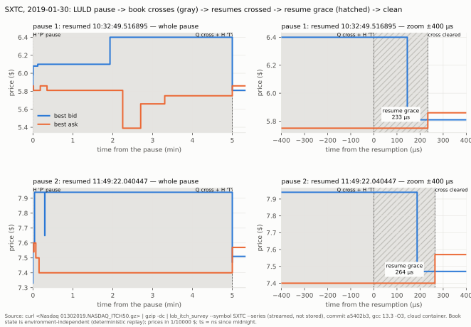
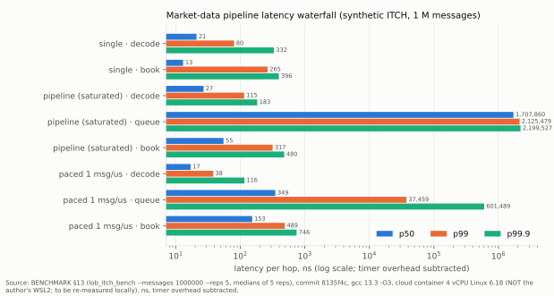
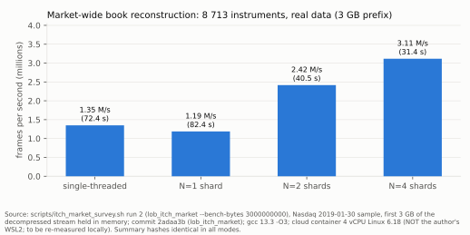

# Deterministic Limit Order Book & Matching Engine

C++20 实现的单线程、确定性、正确性优先的单标的限价订单簿与撮合引擎（L1/L2），
以及在其上的 L3'：Nasdaq TotalView-ITCH 5.0 行情解码与订单簿重建、无锁 SPSC 多线程流水线、策略与事前风控；
L4：OUCH 4.2 / SoupBinTCP 3.00 下单链路（订单网关、单线程 epoll 模拟交易所、锁步与进程内逐位相同）与 tick-to-trade 测量。
目标：价格-时间优先撮合、可复现回放与快照、严格测试（差分 / Golden / Sanitizer / TSan / fuzz）、可审计的基准。

## 关键数字

> **测量环境**：标"本机"的墙钟数字测于作者本机 WSL2（i7-12700H，2026-11-05，3 次运行的中位数；BENCHMARK §13.1 / §14.1 / §15.1，
> 日志在 `MODULE_NOTES/evidence/local_wsl2_2026-11-05/`）；标"云端"的测于云端 4 vCPU 容器，只验证方法，尚未在本机复测。
> 指令数与正确性数字与机器无关。复测（WSL 中、仓库根目录）：
>
> ```bash
> cmake --preset gcc-release && cmake --build --preset gcc-release && taskset -c 2,4 build/gcc-release/bench/lob_itch_bench --messages 1000000 --reps 5
> ```

| 项 | 数值 | 说明 |
|---|---|---|
| ITCH 回放吞吐（单线程，含解码 + 订单簿） | 9.7 M msg/s（本机） | 合成流 1 M 条；云端曾测得 7.7–8.9 M，跨会话、跨机器不做比较 |
| 解码一跳 p50 / p99 | 18 ns / 67 ns（本机） | 单线程模式；扣除计时开销（本机 7.4 ns） |
| 订单簿一跳 p50 / p99 | 12 ns / 237 ns（本机） | 单线程模式 |
| 跨线程交接（限速 1 msg/µs）p50 | 104 ns（本机） | p99 在重复间相差 2.1–40 倍：虚拟化噪声 |
| 风控单次检查 | ≈ 6 ns（本机） | 7 项检查全为整数比较 |
| CRTP vs 虚函数（做市策略一次 `on_book_update`） | 10.8 vs 11.2 ns（本机） | 范围重叠，分辨不出差别，见 BENCHMARK §14.1 |
| 回放峰值内存 | ≈ 47 MB，与输入大小无关（云端） | 33 MB / 328 MB / 984 MB（管道）输入相同 |
| 真实数据回放（Nasdaq 2019-01-30 全天，AAPL） | 11.2 GB / 3.68 亿帧，195.7 s，峰值 RSS 98.7 MiB；0 次 Stale、0 次锁定 / 交叉 | 云端流式（`curl \| gzip -dc \| lob_itch`），耗时受下载速度限制（24 MB/s） |
| 全市场回放（同一天，8 713 只股票） | 单线程 1.35 M 帧/s，N = 2 / 4 分片 2.42 / 3.11 M 帧/s（云端，待本机复测）；峰值在途 1 742 866 单 | 内存中 3 GB 前缀；单线程与分片哈希一致 |
| 多线程 == 单线程回放 | 事件流、订单簿、订单 / 成交 / 持仓哈希逐字节一致 | GCC 与 Clang 固定为同一常量 |
| 热路径分配 | 0 次 | 解码 → SPSC → 订单簿 → 策略 → 风控（L1 撮合引擎除外，D-046）；全市场模式按实测价位峰值预创建后同样为 0（D-058） |
| CI 性能门槛（cachegrind Ir，200 k 条） | decode 33.5 M / book 121.3 M / trading 266.3 M 条指令 | 容差 +2%，`scripts/icount_gate.sh` |
| 交易状态感知 | 只在常规时段 + 个股交易中强制"永不交叉"；停牌 / 集合竞价允许交叉、计数并标记；非交易状态撤单、拒新单 | D-054 |
| 网络下单 == 进程内（锁步） | 订单 / 成交 / 持仓哈希逐位相同（两种成交模型，单线程与流水线） | OUCH 4.2 + SoupBinTCP + 回环 TCP + epoll 交易所，D-063 |
| tick-to-trade p50（tick → 本帧第一条消息） | 本机：进程内编码 0.37 µs；回环 `send()` 返回 1.4 µs，交易所线程忙轮询无变化；往返 447 / 395 µs。云端：0.46 µs；9.1 µs（忙轮询 3.0 µs）；28 / 18 µs | `lob_t2t`，BENCHMARK §15 / §15.1；不是线到线。"回环主要是唤醒成本"只在云端成立；本机慢主要在平台回环本身（同机 netperf TCP_RR 往返约 248 µs） |

## 当前状态（2026-11-05）

| 模块 | 状态 |
|---|---|
| M0 工程骨架（CMake、Presets、警告、Sanitizer、GTest） | ✅ |
| M1 core：类型、命令、拒单码、配置约束、无状态校验 | ✅ 29 个测试，6 个预设通过 |
| M2 book：价格层 + FIFO + ID 索引、不变量检查、强异常保证 | ✅ 48 个测试（含 10 万步差分测试与分配失败注入），6 个预设通过 |
| M3 engine：价格-时间优先撮合、拒单语义、事件流、两阶段异常语义 | ✅ 53 个测试（含事件审计器、10 万条命令的参考引擎差分、逐分配点故障注入），6 个预设通过 |
| M4 testkit：可复用测试基础设施、10 个工作负载画像、长跑与长序列故障注入、M5 契约测试 | ✅ 147 个 CTest 用例（含 10 个画像冒烟长跑）；长跑矩阵见 MODULE_NOTES/M4 |
| M5 replay：文本格式 v1、带校验日志、快照与恢复、提交会话、`lob_replay` | ✅ 见 MODULE_NOTES/M5（含 Golden、逐字节截断、写失败与分配注入、`kill -9` 崩溃测试） |
| M6 bench：四层基准、profiling、优化实验 | ✅ 2026-10-22 验收：基线与对照数据见 [BENCHMARK.md](BENCHMARK.md)，实验见 MODULE_NOTES/M6 |
| L1 冻结评审 | ✅ 2026-10-24 通过（[MODULE_NOTES/L1_REVIEW.md](MODULE_NOTES/L1_REVIEW.md)） |
| L2 性能工程：基线开关 `LOB_BASELINE`、等价性、峰值 RSS、一条命令复现 | ✅ 2026-10-25（BENCHMARK §12、[MODULE_NOTES/L2_EQUIVALENCE.md](MODULE_NOTES/L2_EQUIVALENCE.md)） |
| L3' 阶段 1 行情层：SPSC、ITCH 5.0 解码、`md::Book`、缺口恢复、fuzz / 截断 | ✅ 2026-11-04（[MODULE_NOTES/L3.md](MODULE_NOTES/L3.md)） |
| L3' 阶段 2 流水线与延迟：解码线程 → SPSC → 订单簿线程、延迟瀑布、零分配、异步日志 | ✅ 2026-11-04（BENCHMARK §13） |
| L3' 阶段 3 策略与风控：CRTP 策略、事前风控与熔断、L1 引擎上的两种成交模型、回放 == 流水线 | ✅ 2026-11-04（BENCHMARK §14） |
| L3' 阶段 4 工程化：CI（六预设 + TSan + cachegrind 指令数门槛）、文档 | ✅ 2026-11-04（[docs/INTERVIEW_QA.md](docs/INTERVIEW_QA.md)） |
| L3' 追加：交易状态感知（Trading Action / System Event，D-054） | ✅ 2026-11-04 |
| L3' 真实数据验证：Nasdaq 2019-01-30 全天，AAPL，流式不落盘 | ✅ 2026-11-04：0 次 Stale、0 次锁定 / 交叉，开盘未误判；停牌恢复路径未覆盖（AAPL 当天无停牌），见 [MODULE_NOTES/L3.md](MODULE_NOTES/L3.md) |
| L3' 恢复交易宽限（D-055，真实数据驱动） | ✅ 2026-11-04：SXTC 两次 LULD 暂停恢复时原规则误判 Stale；加宽限后全天 Live，流水线 / 单线程哈希一致 |
| L3' 全市场订单簿（D-056）：共享订单池、按 locate 分片多线程 | ✅ 2026-11-04：真实全天 8 713 只股票全部 Live，峰值在途 1 742 866 单，单线程与 4 分片逐股票哈希一致 |
| L3' 多日验证（2019-01-30 / 08-30 / 12-30，全市场） | ✅ 2026-11-04：三天共 26 040 只股票·日全部 Live、0 Stale；28 次恢复宽限全部解除；每天单线程与 4 分片逐股票哈希一致（见 MODULE_NOTES/L3.md） |
| L4 下单链路：OUCH 4.2 编解码、SoupBinTCP 会话、epoll 模拟交易所、订单网关、锁步 / 自由运行、tick-to-trade | ✅ 2026-11-05（[docs/design/L4_DESIGN.md](docs/design/L4_DESIGN.md)、[MODULE_NOTES/L4.md](MODULE_NOTES/L4.md)、BENCHMARK §15） |
| L5 UDP 组播与 A/B 双路仲裁：MoldUDP64 编码、仲裁器、故障注入与重传服务、真实回环组播、`lob_t2t --udp` | 🚧 进行中（2026-11-07 起，D-066；设计 [docs/design/L5_DESIGN.md](docs/design/L5_DESIGN.md)、进度 [MODULE_NOTES/L5.md](MODULE_NOTES/L5.md)） |

范围：2026-11-05 曾定在 L4 为止（D-065），2026-11-07 扩展到 L5（D-066），分阶段计划与门槛见 [ROADMAP.md](ROADMAP.md) §2.5。
**未来计划（未实施）**：L6 微观结构信号研究（无设计）、独立进程的 `lob_ouch_server`，见 ROADMAP §2.6。

撮合引擎、回放与恢复已可用；性能数据只适用于 WSL2 上的测量环境（BENCHMARK §1），不代表裸机。掉电持久性未验证，见 DESIGN §6.6。 计划与验收门槛见 [ROADMAP.md](ROADMAP.md)。

## 图表

图由 `scripts/charts/make_charts.py` 从 `docs/charts/data/*.csv` 生成；每个 CSV 头部写明数据来源、代码版本与测量环境，并印在图下。



**SXTC 停牌恢复时间线**（Nasdaq 2019-01-30 真实数据，提交 `a5402b3` 的 `lob_itch_survey --series`）：LULD 暂停期间订单簿交叉（灰色），
恢复交易（Cross Trade + H 'T'）时仍交叉；参与撮合的订单的成交回报在之后 233 µs / 264 µs 内到达并消除交叉——这段时间是恢复宽限（斜线，D-055）。
订单簿状态由确定性回放得出，与测量环境无关。



**延迟瀑布**（合成 ITCH 100 万条，`lob_itch_bench`，提交 `8135f4c`，云端 4 vCPU；本机复测见 BENCHMARK §13.1）：饱和流水线的 queue 一跳是排队时间，
限速模式才接近跨核交接成本（BENCHMARK §13）。



**全市场吞吐**（真实数据前 3 GB 放在内存，8 713 只股票，`lob_itch_market --bench-bytes`，提交 `2adaa3b`，云端 4 vCPU，**待本机复测**）：
四种模式汇总哈希一致（D-056）。

## 构建与测试

要求：Linux（开发环境为 WSL2 Ubuntu 24.04）、CMake ≥ 3.25、Ninja、GCC ≥ 13 或 Clang ≥ 18、GoogleTest（缺失时自动下载 v1.14.0）。

```bash
sudo apt-get install -y cmake ninja-build g++ clang libgtest-dev
```

L3' 的 Clang TSan 预设与 libFuzzer 还需要 Clang 运行库，CI 指令数门槛需要 valgrind：

```bash
sudo apt-get install -y libclang-rt-18-dev valgrind
```

单个预设：

```bash
cmake --preset gcc-debug && cmake --build --preset gcc-debug && ctest --preset gcc-debug
```

全部六个预设（GCC/Clang × Debug/Release/ASan+UBSan）：

```bash
scripts/check.sh
```

六个预设 + 两个 TSan 预设（只跑 `concurrency` 标签的测试，L3' 每次提交前运行）：

```bash
scripts/check.sh --tsan
```

示例：

```bash
./build/gcc-debug/examples/core_validation_demo
```

```bash
./build/gcc-debug/examples/book_demo
```

```bash
./build/gcc-debug/examples/engine_demo
```

变异测试（在 `/tmp` 的隔离副本上逐一注入缺陷并重跑全部测试）：

```bash
python3 scripts/mutation/m2_book.py "$PWD"
```

```bash
python3 scripts/mutation/m3_engine.py "$PWD"
```

重新生成 M3 的全部验收证据（全新构建、六预设、差分/注入日志、Demo、变异测试）：

```bash
scripts/evidence_m3.sh
```

长跑（列出画像；运行一个画像；运行完整矩阵）：

```bash
./build/gcc-release/testkit/lob_soak --list
```

```bash
./build/gcc-release/testkit/lob_soak --profile deep_book --seeds 1-10 --commands 200000 --check-every 1000 --require-targets
```

```bash
scripts/soak.sh /tmp/soak
```

重新生成 M4 的全部验收证据（全新构建、回归锚点、LSan 探针、长跑矩阵、变异回归）：

```bash
scripts/evidence_m4.sh
```

## 回放与恢复（M5）

```bash
./build/gcc-release/apps/lob_replay run --commands tests/golden/priority.cmd --journal /tmp/j.log --snapshot /tmp/s.snap --echo
```

```bash
./build/gcc-release/apps/lob_replay verify --journal /tmp/j.log --commands tests/golden/priority.cmd
```

```bash
./build/gcc-release/apps/lob_replay recover --journal /tmp/j.log --snapshot /tmp/s.snap
```

同一命令再次运行 `run` 时，已提交的命令按 `cmd_seq` 去重、不会重复执行；崩溃后重启即用同一命令续跑。`--durable` 在确认前 `fsync`。

重新生成 M5 的全部验收证据：

```bash
scripts/evidence_m5.sh
```

## 基准与 profiling（M6）

测量方法、环境限制与全部结果见 [BENCHMARK.md](BENCHMARK.md)。只在 Release 构建上测量；数字只适用于测量所用的 WSL2 环境。

```bash
cmake --preset gcc-release && cmake --build --preset gcc-release
```

```bash
scripts/bench.sh build/gcc-release/bench/lob_bench /tmp/lob_bench_runs 5
```

```bash
python3 scripts/bench_report.py /tmp/lob_bench_runs
```

两个修订的交替对照（`scripts/bench_compare.sh REV_A REV_B RUNS OUT [--filter …]`）、profiling（`scripts/profile.sh`）、
优化后的完整回归（`scripts/evidence_m6.sh`）的用法见各脚本开头。


### 基线实现与优化实现（L2，`LOB_BASELINE`）

CMake 选项 `LOB_BASELINE`（默认 `OFF`）选择 Session 的实现：`OFF` 编译当前的优化实现 `src/io/session.cpp`；
`ON` 编译 `src/io/baseline/session.cpp`——标签 `m6-baseline` 中 `src/io/session.cpp` 的逐字节副本。两者只有这一个文件不同。
`lob_bench` 的 CSV 中 `env,lob_baseline` 行记录所用实现（0 / 1）。

以下命令与本文件其余命令一样，在 **WSL/Linux shell** 中、仓库根目录下运行（工具链只安装在 WSL 中；
Windows PowerShell 里没有 `cmake`）。从 PowerShell 运行时用 `wsl` 包装，例如：
`wsl -e bash -lc "cd /mnt/g/学习资料/quant && cmake -S . -B build/l2-optimized -G Ninja -DCMAKE_BUILD_TYPE=Release -DLOB_BASELINE=OFF"`。

优化版（默认）：

```bash
cmake -S . -B build/l2-optimized -G Ninja -DCMAKE_BUILD_TYPE=Release -DLOB_BASELINE=OFF
```

```bash
cmake --build build/l2-optimized
```

基线版：

```bash
cmake -S . -B build/l2-baseline -G Ninja -DCMAKE_BUILD_TYPE=Release -DLOB_BASELINE=ON
```

```bash
cmake --build build/l2-baseline
```

两种构建的 CTest 都应全部通过；其中 `IoAllocFailure.CommitRecordStorageDoesNotGrowQuadratically` 在基线构建中断言
相反的结论（分配字节数 > 64 MB），以此证明编译的确实是基线实现。

**一条命令复现整个前后对比**（在 WSL 中运行；2026-10-24 实测 73 分钟，绝大部分是基线 Session 场景的 O(n²) 成本）：从空目录构建两种实现 → 等价性哈希比对 →
吞吐/延迟交替对比（参数同 BENCHMARK §9）→ 峰值 RSS；全部原始数据与汇总 `summary.md` 写入 `MODULE_NOTES/evidence/L2/reproduce/`。

```bash
scripts/l2_reproduce.sh
```

只检查脚本能否跑通（约 2 分钟，数字不是结果）：

```bash
QUICK=1 scripts/l2_reproduce.sh /tmp/l2_smoke
```

## L3' 行情回放（ITCH 5.0）

真实 ITCH 数据不进仓库。下载一个 Nasdaq 公开样本日到 `data/itch/`（已在 `.gitignore` 中；文件数 GB，流式下载、可断点续传）：

```bash
scripts/fetch_itch.sh
```

边解压边回放一只股票（管道 + 固定 1 MiB 读缓冲：内存与文件大小无关，默认配置峰值约 50 MB，开启默认延迟采样约 100 MB）：

```bash
gzip -dc data/itch/01302019.NASDAQ_ITCH50.gz | build/gcc-release/apps/lob_itch --input - --symbol AAPL --stride 400
```

`--mode single` 为单线程回放；两种模式输出的 `event_hash` / `book_hash` 应相同。选项见 `apps/lob_itch.cpp` 头部。

也可以完全不落盘，边下载边回放（2026-11-04 在云端实测：AAPL 全天 195.7 s，峰值 RSS 约 99 MiB，结果见 MODULE_NOTES/L3.md "真实数据验证"）：

```bash
curl -sS --fail "https://emi.nasdaq.com/ITCH/Nasdaq%20ITCH/01302019.NASDAQ_ITCH50.gz" | gzip -dc | build/gcc-release/apps/lob_itch --input - --symbol AAPL --stride 400
```

复现真实数据验证（一次下载经 `tee` 同时送入统计工具 `lob_itch_survey`、`lob_itch` 流水线模式与单线程模式，不落盘；
输出各类消息计数、交易阶段、锁定 / 交叉、每个 Stale 告警及前后消息、全市场日内停牌列表，并比较两种模式的哈希）：

```bash
scripts/itch_real_survey.sh AAPL /tmp/itch_aapl
```

全市场模式（每只股票的订单簿；单线程与 4 分片逐股票哈希比对，再测 N = 1/2/4 的吞吐）：

```bash
scripts/itch_market_survey.sh /tmp/itch_market
```
延迟瀑布与策略 / 风控测量见上方"关键数字"的复测命令；CI 指令数门槛：

```bash
scripts/icount_gate.sh
```

libFuzzer（Clang，60 秒）：

```bash
scripts/fuzz_itch.sh 60
```

## L4 下单链路（OUCH 4.2 / SoupBinTCP 3.00）

策略的订单经风控后由订单网关编码为 OUCH 4.2、装进 SoupBinTCP，经回环 TCP 到单线程 epoll 的模拟交易所（自己的行情订单簿 + 未改动的 L1 撮合引擎）。
锁步模式与进程内模拟逐位相同；自由运行模式检查不变量并两端记录重放（`lob_lockstep_tests`）。tick-to-trade（墙钟，本地运行）：

```bash
cmake --preset gcc-release && cmake --build --preset gcc-release --target lob_t2t
taskset -c 1,2 build/gcc-release/bench/lob_t2t --client-cpu 1 --server-cpu 2 [--busy-poll] [--input data/itch/FILE --symbol AAPL]
scripts/fuzz_ouch.sh 60   # OUCH 编解码的 libFuzzer（需要 clang）
```

## 文档

- [ARCHITECTURE.md](ARCHITECTURE.md) — 模块划分、依赖与数据流
- [DESIGN.md](DESIGN.md) — 数据结构、撮合语义、复杂度
- [DECISIONS.md](DECISIONS.md) — 工程决策与权衡
- [ROADMAP.md](ROADMAP.md) — 实施顺序、L1–L5 验收门槛（L5 进行中）与未来计划（L6，未实施）
- [BENCHMARK.md](BENCHMARK.md) — 基准方法与实测结果
- [MODULE_NOTES/](MODULE_NOTES/) — 各模块技术说明与修改任务
- [AI_USAGE.md](AI_USAGE.md) — AI 参与情况披露
- [docs/INTERVIEW_QA.md](docs/INTERVIEW_QA.md) — L3' 设计问答（memory order、确定性、延迟测量、缺口恢复、风控、指令数门槛）与追问；§8 L4 下单链路（Q13–Q20）
- **复习手册（打印版 PDF）**：[中文版](docs/handbook/handbook-zh.pdf) · [English](docs/handbook/handbook-en.pdf) —— 覆盖 L1–L4 的设计、验证、关键故事与面试问答；
  数字集中在 [docs/handbook/numbers.yaml](docs/handbook/numbers.yaml)（逐项注明出处），本机复测并重新生成：`docs/handbook/remeasure.sh`（见 [docs/handbook/README.md](docs/handbook/README.md)）
- [docs/design/L4_DESIGN.md](docs/design/L4_DESIGN.md) — L4 设计：OUCH / SoupBinTCP 的分工、订单号映射与防重复、断线撤单与限流、tick-to-trade 的定义、网络模式的可验证性
- [docs/design/L5_DESIGN.md](docs/design/L5_DESIGN.md) — L5 设计（2026-11-07 确认，实施中）：MoldUDP64 A/B 组播仲裁、重传服务、故障注入与等价门槛

## 目录结构

```
include/lob/<module>/   公共头文件
src/<module>/           实现
tests/<module>/         GoogleTest 测试（每模块一个可执行文件）
examples/               可运行示例
cmake/                  警告与 Sanitizer 配置
scripts/check.sh        全预设构建 + 测试
scripts/mutation/       模块变异测试脚本
apps/                   lob_replay（回放 / 恢复 / 校验 CLI）、lob_itch（L3' ITCH 回放）
docs/                   面试问答
.github/workflows/      CI
testkit/                测试基础设施（仅测试构建）、长跑工具 lob_soak、命令生成器 lob_gen_commands
tests/golden/           Golden 场景（命令、日志、快照）
```
